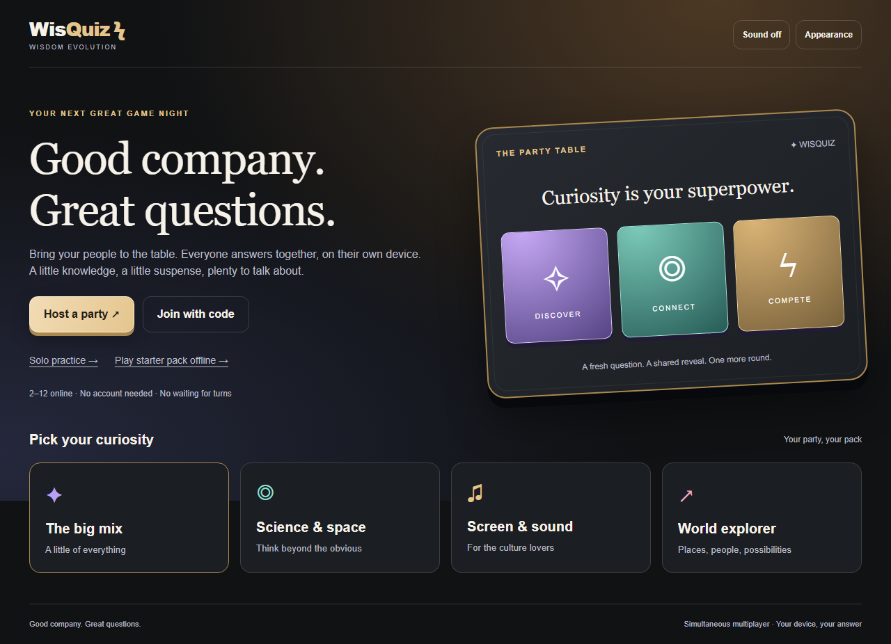

# WisQuiz

A modern trivia party table. **Everyone answers the same question at the same time on their own device**, then shares the reveal. No account or paid service is required for the core game.



## Play

- Host a party, choose your name/avatar and share its six-character code, link or QR.
- Up to 12 players join. Guests mark themselves ready; the host starts.
- Answers and score changes stay private until the shared reveal. Each answer is acknowledged by the server.
- Correct answers earn 100 points plus 10 per whole second remaining, capped at 100 bonus points. Maximum 200 points at every timer preset.
- Choose 5/10/15/20 questions, category, difficulty, 10/15/20/30-second answer windows and 4/5/8/12-second reveals (4 seconds by default).
- Rematch with the same party/settings. Review answers, accuracy and longest streak.
- Solo supports timed/untimed practice, a best for matching settings, and a bundled pack independent of the question provider.
- Three persistent themes: Midnight Social, Prism Lounge and Neon Studio. Sound controls, reduced motion, keyboard answers 1–4 and accessible status feedback. Motion settings preserve the full reveal reading time.

Pass-and-play and turn-based modes are deferred to a separate version. The table presentation does not change simultaneous multiplayer.

## Run locally

Node.js 22+ and pnpm 11.25+:

```powershell
pnpm install
pnpm dev
```

Open [localhost:3000](http://localhost:3000). Room Worker: port 1999. `pnpm dev:next` / `pnpm dev:party` run them separately. See [USAGE.md](USAGE.md) for examples, offline play and deployment.

## Architecture

- Next.js 16, React 19 and TypeScript; accessible DOM/CSS tactile table.
- Shared rules in `lib/game-engine.ts`, with explicit trusted time inputs and deadline guards.
- PartyServer on Cloudflare Workers; one SQLite-backed Durable Object per room. Persisted state/alarms replace process timers. WebSocket hibernation avoids continuous room compute.
- Random per-room seat secrets travel inside WebSocket join messages, are hashed server-side and never appear in URLs/public state. Keep original browser storage to resume. Clearing it loses recovery.
- Ten-second host reconnect grace; longer absence transfers controls. Accepted answers survive refresh and room-process restarts.
- Open Trivia DB fetches once per match with a bounded timeout. An original 100-question pack provides fallback/offline decks. If the chosen local difficulty has too few unique questions, the pack mixes difficulty and the UI labels this.
- Public state contains answered status, previous-round scores and deadlines. Correctness, answer choices and score deltas appear only at reveal. Own accepted answers are unicast.
- Production service worker caches public lounge/solo HTML and static assets, never room state/API responses/WebSockets. Solo starter play runs entirely in the app; internet multiplayer still needs coordination.

## Free hosting

Player details and game setup stay out of room URLs. Only the room code is shared; tab-local session storage carries initial setup and the Worker validates settings/host authority. Editing old query parameters cannot change room setup or grant host access. Invitees enter their own names, and authenticated seats still resume after refresh.

**Vercel hosts the frontend; deploy the multiplayer Worker separately to Cloudflare.** Then set `NEXT_PUBLIC_MULTIPLAYER_HOST` in Vercel and redeploy the frontend. Vercel deployment alone cannot run this project's Cloudflare room server. Follow the [step-by-step Vercel + Cloudflare setup and troubleshooting](USAGE.md#vercel-frontend--cloudflare-multiplayer-first-deployment).

On Windows, double-click **Setup-Cloudflare.cmd** to install dependencies, authorize Cloudflare, deploy the Worker and print the Vercel setting. Complete the browser login when prompted; the script does not change your hosting plan or Vercel settings.

Retain an eligible free frontend host and deploy rooms directly to your Cloudflare account with Wrangler. `wrangler.jsonc` creates **SQLite-backed** Durable Objects, eligible for Workers Free. Quotas are finite; verify account eligibility and actual traffic before publishing. No paid plan or cloud resource was provisioned by this implementation.

The retired PartyKit endpoint was removed from `vercel.json`. Set `NEXT_PUBLIC_MULTIPLAYER_HOST` to the deployed Worker **hostname**, without scheme/path, and rebuild. `NEXT_PUBLIC_PARTYKIT_HOST` remains a migration alias; remove/update stale hosting-dashboard values. Local default: `localhost:1999`.

[Cloudflare free-tier requirements](https://developers.cloudflare.com/durable-objects/platform/pricing/), [PartyKit retirement notice](https://docs.partykit.io/guides/deploy-to-cloudflare/), [Vercel Hobby personal/non-commercial scope](https://vercel.com/docs/plans/hobby).

## Validate

```powershell
pnpm type-check
pnpm test:engine
pnpm exec playwright install chromium
pnpm test
pnpm build
pnpm test:pwa
pnpm deploy:check
```

Browser tests start both services and use bundled questions for deterministic multiplayer. Live multiplayer checks are required and do not silently skip. Opt-in transport/restart rehearsals are described in [USAGE.md](USAGE.md).

See [validation evidence](docs/revamp/implementation/VALIDATION.md), [transport contract](docs/revamp/MULTIPLAYER_TRANSPORT.md), [revamp plan](docs/revamp/REVAMP_PLAN.md) and [mocks](docs/revamp/mocks/README.md). Local build/emulator checks do not establish deployed quota eligibility or physical mobile-device performance.
