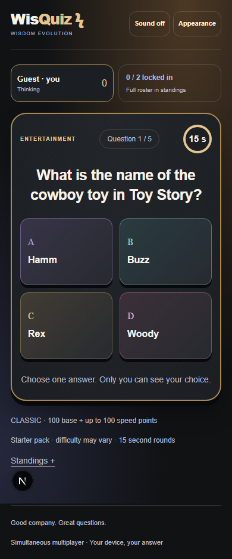
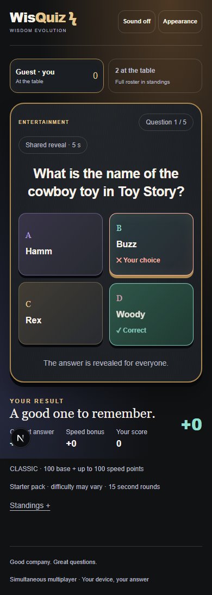
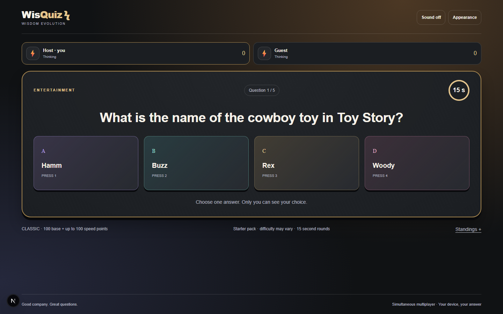

# WisQuiz implementation validation

9 October 2026. Delivered locally in `Games`; no cloud deployment/account changes.

## Delivered

Simultaneous Classic multiplayer on independent devices, up to 12 seats. New lounge/lobby/table/reveal/results flow, three persistent themes, sound/motion preferences, keyboard answers, pack/difficulty/timer/length settings, QR/link invitations, ready states, same-room rematch, score/accuracy/streak summaries and answer review. Phone layout shows own seat plus collective answer progress, with full standings expandable.

Solo shares the rules engine, supports timed/untimed practice, matching-settings personal bests, a bundled original 100-question pack and production offline loading. Pass-and-play is deliberately excluded from this release per the approved scope clarification.

PartyServer/Wrangler replace hosted PartyKit deployment; SQLite Durable Objects configuration is eligible for Cloudflare Workers Free subject to account/quota checks. Seat secrets stay out of URLs and public state, scores/answer choices remain private before reveal, command validation rejects invalid/stale/late answers, accepted answers persist, host reconnection has a ten-second grace, and phase deadlines use durable alarms.

## Evidence

| Check | Result |
|---|---|
| TypeScript `tsc --noEmit` | Passed |
| Next.js production build | Passed |
| Pure engine/provider tests | 11 passed; no skips |
| Required Chromium UI suite | 10 passed; no skips |
| Real two-browser match | Five rounds, simultaneous answer access, private choices, host refresh, full reveals, review and same-room rematch passed |
| Real WebSocket transport | 12 seats, same-nickname isolation, capacity rejection, readiness/start validation, answer privacy, accepted-answer reconnect, five complete rounds and rematch passed |
| Host grace/succession | Short reconnect preserves host; sustained absence transfers controls via alarm; passed |
| Isolated Worker restart | Persisted ID, accepted answer, hidden scores, deadline and alarm reveal survive process stop/restart on port 2001; passed |
| Responsive stress fixture | 12 seats, long question/answers at 320×568, 390×844, 844×390, 768×1024, 1440×900; answer bounds contained and no overlap; passed |
| Zoom/motion | 200% CSS zoom containment, keyboard selection and full five-second solo reveal under reduced motion; passed |
| Revised compact phone layout | Focused layout checks rerun; passed |
| Production service worker | Online shell precache → browser offline → cold solo route navigation → playable deck → answer reveal, with no page errors; passed |
| Worker deployment dry run | Passed; 66.13 KiB upload / 19.49 KiB gzip; SQLite binding present; no actual deploy |

The transport/restart tests are opt-in and were explicitly enabled during validation. The required browser test starts both services and does not silently skip multiplayer. Browser contexts and sockets simulate players; these are not claims of twelve physical phones tested.

## Screenshots

| Real multiplayer question, phone | Real multiplayer reveal, phone |
|---|---|
|  |  |

Additional `question-WxH.png` files are clearly labeled **layout validation fixtures**, with synthetic long content and 12 seats. `lounge-*.png` show the three themes with the appearance panel open. `production-offline-reveal.png` is actual production solo running offline. Generated concept boards remain separate under `../mocks` and are not implementation screenshots.

## Remaining external checks / future scope

- No Cloudflare account authentication, plan/usage dashboard inspection or live cloud deployment was performed. Supply the deployed Worker hostname and set/rebuild frontend environment configuration before remote play. Existing external PartyKit deployment was not modified.
- Cloud free tiers are finite. SQLite eligibility/configuration and dry-run bundling are verified; a live account's quotas and actual traffic are not.
- Safari/iOS/Android hardware, network variability and long-session performance still need release-device checks. Install metadata and browser offline behavior were tested; native packages were not built.
- Curated categories may broaden difficulty when a local level has too few unique questions; this is disclosed in the UI. Questions do not repeat within one local deck. Fresh rematches reshuffle/reload but can repeat questions from earlier matches; session-wide history exclusion remains future work.
- Difficulty labels for original questions are editorial estimates. No fact explanations are fabricated. Provider content is validated and rendered as text.
- Sound/motion settings are persisted; browser autoplay rules may require a user gesture before audio can play. Only the production offline test explicitly collected page errors; a full cross-browser console/audio audit remains open.
- Confidence, teams, spectators, pass-and-play, desktop LAN hosting and Vite consolidation remain optional future milestones.

Run instructions: [USAGE.md](../../../USAGE.md). Transport details: [MULTIPLAYER_TRANSPORT.md](../MULTIPLAYER_TRANSPORT.md). Original unrelated ZIP deletion and local PartyKit state were preserved.
