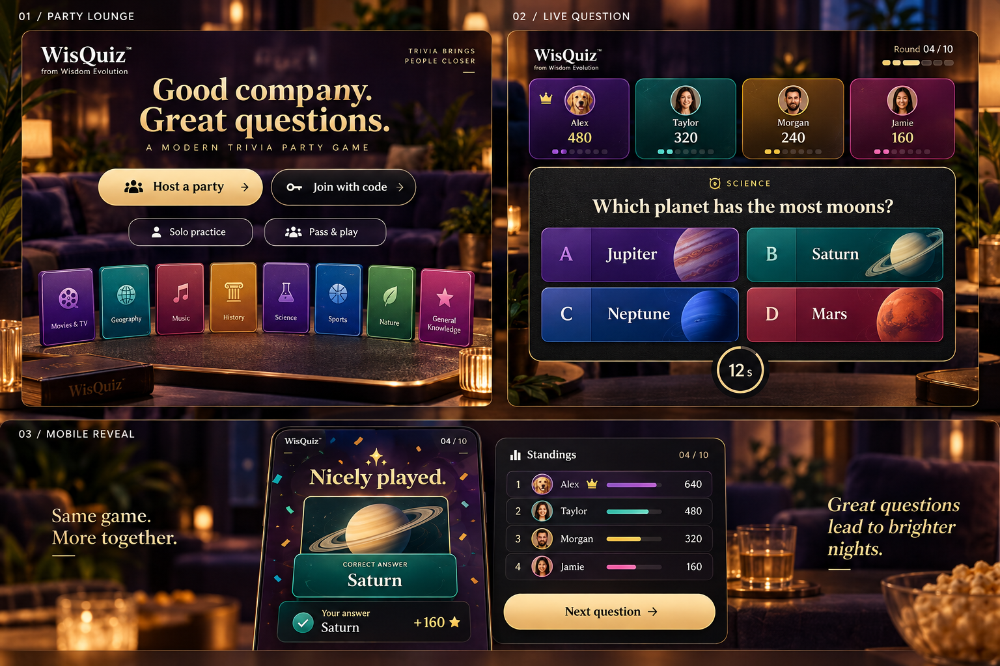
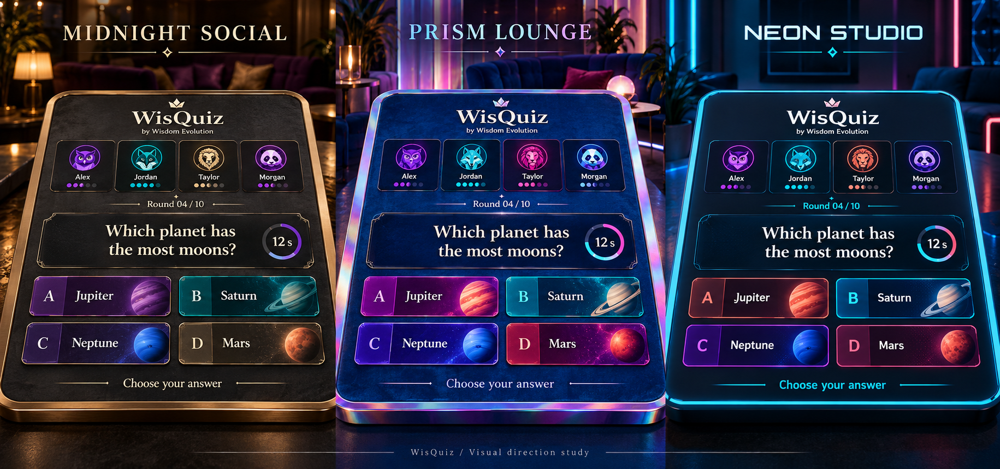

# WisQuiz revamp mocks

Open `index.html` in a browser. This standalone, offline HTML mock has no dependencies and makes no network calls.

- Review lounge, lobby, live question, reveal, final results and local handoff using the toolbar.
- Compare Midnight Social, Prism Lounge and Neon Studio using the theme selector.
- Toggle Phone preview or resize the browser to inspect responsive composition.
- Click an answer or press 1–4, then Preview the reveal to inspect correct/incorrect states.
- Settings, rosters, timers, final scores, copy and sound are illustrative. There are no real rooms, clipboard writes or audio effects.
- The local handoff is a composition preview; its ready button leads to the same online question fixture.

The generated concept boards are material/layout references. Read `../REVAMP_PLAN.md` for scope, implementation order, sources and acceptance criteria. No application code has been redesigned.

Theme-board prompt/provenance: `theme-prompt.txt`. These boards propose tactile materials; the shipped interface will keep question/answer text flat and readable, without requiring the generated perspective.

Prompt/provenance: `concept-prompt.txt`. Built-in image_gen, 9 October 2026. The concept board has been visually inspected; generated text and example facts are illustrative. `VALIDATION.json` records static HTML and JavaScript checks. In-app browser inspection was blocked because file URLs are disallowed, so actual viewport layout and interaction have not been browser-verified.
